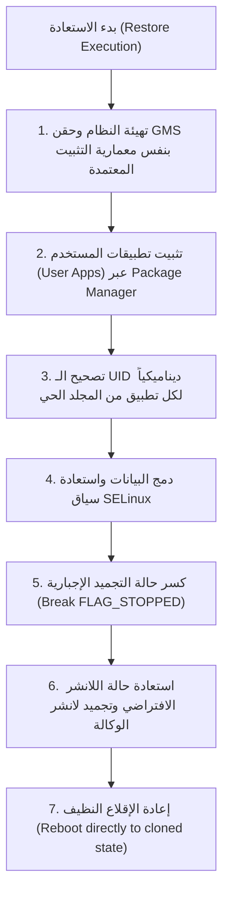

# 📋 التقرير الهندسي الشامل: منظومة النسخ الاحتياطي والاستعادة (Aero Suite — Backup & Restore Architecture)

---

## 🎯 1. الهدف الأساسي والنهائي (The Core Objective)
**الهدف المطلوب تحقيقه بنسبة 100%:**
الحصول على **نسخة طبق الأصل (1:1 Complete Vehicle State Clone)** من نظام أندرويد والبيانات والتطبيقات على شاشة السيارة (Dongfeng Shine / Aeolus D53)، بحيث لو قمنا بعمل **Factory Reset** كامل أو مسح شامل للشاشة، وبمجرد وضع فلاشة الـ **Restore**:
1. تعود الشاشة والسيارة لنفس الحالة اللحظية التي أُخذت منها النسخة.
2. **خدمات جوجل (GMS)** ومتجر Google Play يعملان بكفاءة تامة دون الوقوف على الـ Pending.
3. جميع **حسابات جوجل (Google Accounts)**، التوكنات، وحسابات النظام تعود مفعلة ومسجلة دون طلب تسجيل دخول جديد.
4. جميع **تطبيقات المستخدم (User Apps)** مثبتة ومتاحة وتعمل وتستقبل أوامر النظام والخلفية.
5. جميع **بيانات التطبيقات (App Data & Settings)** محفوظة بدقة، على سبيل المثال لانشر AGAMA يعود بكافة الثيمات، أزرار التطبيقات، التراخيص، وإعدادات المستخدم دون أن يفتح كأنه تطبيق جديد.
6. **اللانشر الافتراضي (Default Home)**: إذا كان لانشر الوكالة الأصلي معمولة تجميد (Freeze) وكان المستخدم معتمداً على لانشر بديل (مثل AGAMA أو Car Launcher)، يعود لانشر الوكالة متجمداً تلقائياً، ويعود اللانشر البديل هو الواجهة الأساسية التي تقلع عليها الشاشة فوراً.
7. **إعدادات النظام والاتصالات**: شبكات الـ Wi-Fi، اقترانات الـ Bluetooth، وضع المطورين (ADB)، وإعدادات الصوت والسيارة كما هي.
8. **ملفات الميديا والتخزين الداخلي**: ملفات `/sdcard` والموسيقى والفيديوهات تعود إلى مساراتها الأصلية.

---

## ⚙️ 2. كيف تعمل الآلية حالياً بالتفصيل (Current Implementation Breakdown)

### أ. كيف نقوم بتثبيت خدمات جوجل (GMS Installation Flow)
في كود `prepare_install_gms_usb`، تمر العملية بالمراحل التالية:
1. **التهيئة والتحضير**: يتم فحص ملفات حزمة جوجل الرسمية المتوافقة (Google Play Store, Google Play Services, Google Services Framework, Google Account Manager).
2. **التنظيف المسبق الصارم (Pre-Clean)**:
   - حذف أي نسخ قديمة من حزم جوجل الأربعة من مسارات `/data/app` و `/system/priv-app`.
   - مسح الكاش وبيانات التطبيقات القديمة لمنع تضارب الشهادات (Signatures Mismatch).
   - مسح قواعد بيانات الحسابات التالفة `accounts.db` في `/data/system/users/0/`.
3. **الحقن في النظام (System Injection)**:
   - إعادة تركيب قسم النظام بصلاحية الكتابة: `mount -o remount,rw /system`.
   - استخراج وتضمين مكتبات الـ C++ الأصلية (`lib/arm/*.so`) داخل مجلد كل حزمة.
   - نسخ المجلدات إلى مسار النظام المحمي: `/system/priv-app/`.
   - ضبط الصلاحيات القياسية: المجلدات `0755` وملفات الـ APK بـ `0644`.
4. **حقن الصلاحيات والتسجيل**:
   - كتابة تصريح التعرف على الصوت: `/system/etc/permissions/voice_recognizers.xml`.
5. **تجاوز إعدادات شاشة التهيئة (Bypass Provisioning & Setup Wizard)**:
   - تنفيذ الأمرين الأساسيين:
     ```bash
     settings put global device_provisioned 1
     settings put secure user_setup_complete 1
     ```
   - *الهدف منهما*: إعلام نظام أندرويد وخدمات Google Play بأن إعدادات المستخدم والنظام مكتملة، مما يمنع تعليق التحميل على وضعية "Pending" في متجر جوجل.
6. **إعادة التشغيل**: عمل `sync` للذاكرة ثم `reboot` لإعادة تحميل الـ Dalvik/ART Cache.

---

### ب. كيف نأخذ النسخة الاحتياطية حالياً (Backup Mechanism Flow)
في كود `prepare_backup_usb`، يقوم السكريبت عند توصيل الفلاشة بالسيارة بنسخ البيانات إلى مسار `USB:/Backup/` عبر المستويات التالية:
1. **إعدادات النظام والصلاحيات**:
   - نسخ `settings_*.xml`, `runtime-permissions.xml`, `package-restrictions.xml`, `appops.xml` من `/data/system/users/0/`.
   - نسخ خصائص النظام `build.prop` و `/data/property/*`.
2. **تطبيقات النظام المضافة (Custom System Apps)**:
   - فحص مجلدات `/system/priv-app` و `/system/app`.
   - مقارنة كل تطبيق مع القائمة البيضاء لوكالة دونج فينج (Dongfeng Factory Whitelist المكونة من 69 priv-app و 33 system-app).
   - أي تطبيق لا ينتمي لمصنع السيارة (مثل GMS، أو لانشر مثبت كنظام) يتم نسخه إلى الفلاشة `Backup/system_apps/`.
3. **حسابات المستخدم وبيانات جوجل (Accounts & GMS Data)**:
   - نسخ `accounts.db` و `accounts_de.db` من مسار `/data/system/users/0/`.
   - نسخ بيانات مزامنة الحسابات `/data/system/sync/`.
   - نسخ جميع مجلدات بيانات خدمات جوجل `/data/data/com.google.*`.
4. **تطبيقات المستخدم (User Apps)**:
   - نسخ كامل مجلدات حزم المستخدم من `/data/app/*` إلى `Backup/data_apps/`.
5. **قواعد بيانات وبيانات التطبيقات (App Data & Databases)**:
   - نسخ `/data/data/<pkg>` لكل تطبيق مستخدم، وتطبيقات النظام المعدلة، وقائمة حزم معروفة (مثل AGAMA Launcher، SmartTube، إلخ).
6. **الواي فاي والبلوتوث (Wi-Fi & Bluetooth)**:
   - نسخ ملفات الإعدادات من `/data/misc/wifi`, `/data/misc/bluetooth`, `/data/misc/bluedroid`.
7. **التخزين الداخلي (Internal Storage)**:
   - نسخ ملفات `/data/media/0` (أو `/sdcard`) في حالة تفعيل خيار Media.

---

### ج. كيف تتم الاستعادة حالياً (Restore Mechanism Flow)
في كود `prepare_restore_usb`، يقوم سكريبت `custom_rep.sh` بالخطوات التالية:
1. تركيب قسم النظام: `mount -o remount,rw /system`.
2. إلغاء تجميد اللانشر الأصلي مبدئياً: `pm enable com.qinggan.app.launcher`.
3. نسخ الـ System Apps من الفلاشة إلى `/system/priv-app/` و `/system/app/` وضبط صلاحياتها وملفات الـ `.so`.
4. نسخ ملفات الحسابات `accounts.db` إلى `/data/system/users/0/`.
5. نسخ ملفات إعدادات XML وضبط ملكيتها للنظام: `chown system:system`.
6. تثبيت الـ User Apps عبر أوامر:
   - محاولة التثبيت عبر `pm install-create` و `pm install-commit`.
   - أو الرجوع لتثبيت الـ APK مباشرة: `pm install -r <apk>`.
7. استعادة مجلدات البيانات من `Backup/data_data/` إلى `/data/data/` ومحاولة إعطاء الملكية بناءً على قراءة معرف المستخدم من `packages.list`.
8. استعادة ملفات الواي فاي، البلوتوث، والملفات الشخصية `/sdcard`.
9. فحص ملف `package-restrictions.xml`: إذا كان اللانشر الأصلي متجمداً، ينفذ `pm disable com.qinggan.app.launcher`.
10. إعادة تشغيل النظام: `reboot`.

---

## 🛑 3. المشاكل والعيوب الفعلية التي ظهرت أثناء التجربة (Empirical Issues Observed)

### المشكلة الأولى: خدمات جوجل تالفة، المتجر لا يفتح كأنه مثبت بشكل خاطئ
* **الأعراض**: بعد الـ Restore تجد تطبيق Play Store موجوداً ولكنه يعلق ولا يفتح أو تنهار الخدمات، ولا تجد حسابات جوجل تعمل.
* **السبب الجذري في الكود**:
  1. في الـ Restore الحالي، يتعامل السكريبت مع خدمات جوجل كأنها مجرد ملفات يتم رميها في `/system/priv-app/` دون مراعاة تسلسل تهيئة بيئة جوجل.
  2. لم يتم تطبيق أمري التفعيل الحيويين في سكريبت الريستور:
     ```bash
     settings put global device_provisioned 1
     settings put secure user_setup_complete 1
     ```
     مما جعل النظام بعد الفورمات يعتبر أن إعدادات التجهيز (Setup Wizard) لم تكتمل، فيظل متجر جوجل معلقاً ومحظوراً من تشغيل خدمات التحميل والمزامنة.
  3. استعادة ملفات `accounts.db` التابعة لقسم مشفر أو بدون التوافق مع مفاتيح التشفير التي أُعيد إنشاؤها بعد الفورمات يؤدي إلى رفض Android Keystore لرموز الدخول السابقة لحسابات Google.

---

### المشكلة الثانية: التطبيقات مثبتة ولكنها لا تعمل والنظام لا يشعر بها بعد الإقلاع
* **الأعراض**: بعد انتهاء الـ Restore وإعادة التشغيل، تفتح الشاشة على لانشر الوكالة الأساسي كأن شيئاً لم يحدث، ولا يوجد أي تطبيق من تطبيقاتك يعمل في الخلفية.
* **السبب الجذري في نظام أندرويد**:
  1. **حالة التجميد الإجبارية (Android Stopped State / FLAG_STOPPED)**:
     - أمان نظام أندرويد يفرض أن أي تطبيق يتم تثبيته عبر أمر `pm install` من الخارج، يوضع تلقائياً في حالة تسمى `STOPPED`.
     - في هذه الحالة، التطبيق **ممنوع كلياً من استلام أي إشارات نظام (Broadcast Receivers) بما فيها إشارة بدء تشغيل السيارة `BOOT_COMPLETED`**، ولا يمكنه إطلاق أي Background Service حتى يقوم المستخدم بفتحه يدوياً بالنقر عليه مرة واحدة على الأقل.
  2. **فشل فحص إيقاف اللانشر الأساسي**:
     - كود الريستور يفحص عبارة محددة في `package-restrictions.xml`:
       ```bash
       grep -q 'name="com.qinggan.app.launcher".*enabled="2"' ...
       ```
     - في حال كان التجميد في أندرويد مسجلاً بصيغة أخرى، أو كان النظام قد أنشأ ملف `package-restrictions.xml` جديداً أثناء الإقلاع ومسح السطر القديم، يظل لانشر الوكالة نشطاً، ولا يتم تحفيز اللانشر البديل.

---

### المشكلة الثالثة: ضياع بيانات التطبيقات (مثل AGAMA كأنه متسطب جديد)
* **الأعراض**: تفتح تطبيق AGAMA أو أي برنامج آخر، فتجده في شاشة البداية، ولا يتذكر أي إعداد، وكأن مجلد البيانات فارغ.
* **السبب الجذري الحاسم (Android Linux UID Mismatch)**:
  1. نظام أندرويد مبني على Linux، ولكل تطبيق مستخدم مُعرّف أمان فريد وخاص به يسمى **UID** (مثل `u0_a84`).
  2. عندما يقوم سكريبت الـ Restore بتثبيت تطبيق AGAMA لأول مرة بعد الفورمات عبر `pm install`، يقوم أندرويد بتخصيص **UID جديد تماماً** للتطبيق قد لا يطابق الـ UID القديم الذي كان موجوداً قبل الفورمات.
  3. بعد التثبيت، يقوم السكريبت بنسخ ملفات الباك آب القديمة داخل `/data/data/altergames.carlauncher/`.
  4. انظر ماذا كان يفعل السكريبت لضبط المالك (Ownership):
     ```bash
     puid=$(awk -v p="$pname" '$1==p {print $2}' /data/system/packages.list)
     if [ -n "$puid" ]; then
         chown -R "$puid:$puid" "$dest_dir"
     else
         chown -R 1000:1000 "$dest_dir"
     fi
     ```
     * في أحيان كثيرة، إذا فشل استخراج الـ UID، يقوم السكريبت بتحويل ملكية المجلد إلى `1000:1000` (الذي هو مستخدم النظام `system`).
     * حتى لو استخرج قيمة قديمة لا تطابق معرّف التطبيق الجديد، تحدث كارثة في الصلاحيات تسمى **`EACCES (Permission Denied)`**!
     * عند إقلاع التطبيق، يحاول قراءة ملف الإعدادات `shared_prefs` وقاعدة البيانات، فيرفض نظام أندرويد السماح له بقراءتها لأنها مملوكة لـ UID مختلف!
     * ماذا يفعل أي تطبيق أندرويد عندما يُمنع من قراءة قواعد بياناته؟ يفترض تلقائياً أنها تالفة، ويقوم بإنشاء ملفات افتراضية جديدة فارغة، فيفتح أمامك كأنه تطبيق جديد تماماً!

---

## 🛠️ 4. الحلول الهندسية المقترحة للمراجعة (Proposed Engineering Solutions)

لكي نحقق الـ 1:1 Clone الكامل بدون ثغرات، نقترح اعتماد الآليات الدقيقة التالية:



### 1. توحيد هندسة تثبيت خدمات جوجل أثناء الـ Restore
* لا نكتفي بنسخ ملفات عشوائية، بل إذا وجد السكريبت حزم GMS في الباك آب، يُطبق نفس خطوات التثبيت الناجحة:
  - تنظيف أية تعارضات.
  - حقن الحزم في `/system/priv-app`.
  - ضبط أذونات `voice_recognizers.xml`.
  - تنفيذ أمري التجهيز الحيويين إجبارياً:
    ```bash
    settings put global device_provisioned 1
    settings put secure user_setup_complete 1
    ```

### 2. الحل الهندسي الجذري لبيانات التطبيقات (Dynamic UID Resolution)
* لمنع مشكلة تصفير بيانات AGAMA والتطبيقات:
  1. بعد تنفيذ `pm install` للـ APK، ننتظر لحظة حتى يُنشئ أندرويد مجلد التطبيق الرسمي.
  2. نقوم بقراءة الـ **UID الحقيقي الحيّ** الذي خصصه أندرويد للتطبيق في هذه اللحظة مباشرة من خصائص المجلد:
     ```bash
     APP_UID=$(stat -c %u /data/data/<package_name>)
     ```
  3. نقوم بنسخ ملفات الباك آب القديمة (`shared_prefs`, `databases`, `files`) إلى داخل المجلد.
  4. نُعيد ضبط الملكية وسياق الأمان فوراً بنفس الـ UID الفعلي الحيّ:
     ```bash
     chown -R $APP_UID:$APP_UID /data/data/<package_name>
     restorecon -R /data/data/<package_name>
     ```
  * **النتيجة**: عند فتح التطبيق، يجد ملفات إعداداته مملوكة لنفس الـ UID الخاص به، فيقرأها فوراً دون أي خطأ صلاحيات وتعود جميع الواجهات كما كانت.

### 3. إيقاظ التطبيقات وكسر حالة التجمد (Awakening from Stopped State)
* بعد اكتمال تثبيت التطبيقات واستعادة بياناتها، يقوم السكريبت بإرسال أمر تنشيط لكل تطبيق (مثل: `am force-stop` متبوعاً بأمر فحص مكونات أو إطلاق غير مرئي) لإزالة علامة `FLAG_STOPPED` من مدير الحزم، حتى تصبح التطبيقات قادرة على استقبال أحداث النظام والتشغيل التلقائي.

### 4. حسم اللانشر الافتراضي وتجميد لانشر الوكالة
* إذا كان في النسخة الاحتياطية لانشر مخصص (مثل `altergames.carlauncher` أو غيره):
  - يقوم السكريبت بتعيين اللانشر المخصص كمعالج رئيسي للفئة الافتراضية `android.intent.category.HOME`.
  - التحقق الصارم من حالة تجميد لانشر الوكالة الأصلي:
    ```bash
    pm disable com.qinggan.app.launcher
    ```
  - وبذلك تقلع الشاشة مباشرة على اللانشر المطلوب.

---

## 📌 خلاصة واستفسار لمناقشتها مع مستشارك أو مراجعتك الشخصية:
1. هل آلية استخراج الـ **UID الفعلي الحيّ عبر `stat -c %u`** بعد التثبيت مباشرة هي الأسلوب المفضل لديه لتفادي أزمة تشفير ومطابقة معرّفات أندرويد Linux Permissions؟
2. هل نعتمد استدعاء دورة تثبيت الـ GMS بالكامل داخل سكريبت الـ Restore لضمان عدم تعليق المتجر وخدمات الحسابات؟
3. هل هناك تفضيل لأمر معين لتسجيل اللانشر كـ Default Home في نظام دونج فينج (عبر `cmd package set-home-activity` أو تعديل `package-restrictions.xml`)؟

---

## 💻 5. نصوص الأكواد الفعلية الكاملة من النظام (Full Actual Source Code Reference)

فيما يلي الأكواد والسكريبتات التنفيذية كاملة كما هي مبرمجة حالياً في ملف `src/payload_engine.py`:

### [1] كود سكريبت تثبيت خدمات جوجل (Install GMS Shell Script)
```bash
#!/system/bin/sh
# ==========================================
# AERO SUITE — GMS FRAMEWORK INSTALLER
# ==========================================

USB_PATH=""
for dir in /storage/* /mnt/media_rw/* /mnt/usb* /storage/usb*; do
    if [ -f "$dir/update/custom_rep.sh" ]; then
        USB_PATH="$dir"
        break
    fi
done
if [ -z "$USB_PATH" ]; then
    USB_PATH=$(dirname $(dirname "$0"))
fi

LOG_FILE="$USB_PATH/gms_install.log"
echo "=== AERO GMS INJECTION START ===" > "$LOG_FILE"
date >> "$LOG_FILE"

mount -o remount,rw /system >> "$LOG_FILE" 2>&1
mount -o rw,remount /system >> "$LOG_FILE" 2>&1

# 0. Deep Pre-Clean: Completely wipe any existing/stale Google packages, leftover data & caches
# Prevents signature mismatch, corrupted databases, and package manager conflicts
echo "Executing pre-installation purge of existing Google packages & caches..." >> "$LOG_FILE"
for pkg in com.android.vending com.google.android.gms com.google.android.gsf com.google.android.gsf.login; do
    PKG_PATH=$(pm path "$pkg" 2>/dev/null | cut -d ':' -f 2)
    if [ -n "$PKG_PATH" ]; then
        echo "  Found existing package $pkg at $PKG_PATH — purging completely..." >> "$LOG_FILE"
        rm -rf $(dirname "$PKG_PATH") >> "$LOG_FILE" 2>&1
    fi
    pm clear "$pkg" >> "$LOG_FILE" 2>&1
    pm uninstall "$pkg" >> "$LOG_FILE" 2>&1
    rm -rf "/data/data/$pkg" >> "$LOG_FILE" 2>&1
    rm -rf "/data/user/0/$pkg" >> "$LOG_FILE" 2>&1
    rm -rf "/data/app/$pkg"* >> "$LOG_FILE" 2>&1
    rm -rf "/data/dalvik-cache/arm/*$pkg"* >> "$LOG_FILE" 2>&1
done

# Wipe old system directory remnants
rm -rf /system/priv-app/*PlayStore* /system/priv-app/*playstore* /system/priv-app/*vending* >> "$LOG_FILE" 2>&1
rm -rf /system/priv-app/*GMS* /system/priv-app/*gms* /system/priv-app/*GSF* /system/priv-app/*gsf* >> "$LOG_FILE" 2>&1
rm -rf /system/app/*PlayStore* /system/app/*GMS* /system/app/*GSF* >> "$LOG_FILE" 2>&1

# Reset corrupted account tokens and sync db to prevent auth conflict
rm -rf /data/system/users/0/accounts.db* >> "$LOG_FILE" 2>&1
rm -rf /data/system_de/0/accounts_de.db* >> "$LOG_FILE" 2>&1
rm -rf /data/system/sync/* >> "$LOG_FILE" 2>&1

SOFT_DIR="$USB_PATH/update/soft"
if [ -d "$SOFT_DIR" ]; then
    for item in "$SOFT_DIR"/*; do
        if [ -d "$item" ]; then
            appname=$(basename "$item")
            echo "Injecting GMS component: $appname" >> "$LOG_FILE"
            TARGET_DIR="/system/priv-app/$appname"
            mkdir -p "$TARGET_DIR" >> "$LOG_FILE" 2>&1
            cp -r "$item"/* "$TARGET_DIR/" >> "$LOG_FILE" 2>&1
            chmod 755 "$TARGET_DIR" >> "$LOG_FILE" 2>&1
            chmod 644 "$TARGET_DIR"/*.apk >> "$LOG_FILE" 2>&1
            if [ -d "$TARGET_DIR/lib" ]; then
                chmod -R 755 "$TARGET_DIR/lib" >> "$LOG_FILE" 2>&1
                chmod 644 "$TARGET_DIR/lib/arm"/*.so >> "$LOG_FILE" 2>&1
            fi
        fi
    done
fi

# Inject voice_recognizers permission if available
cat << 'EOF' > /system/etc/permissions/voice_recognizers.xml
<?xml version="1.0" encoding="utf-8"?>
<permissions>
    <feature name="android.software.voice_recognizers" />
</permissions>
EOF
chmod 644 /system/etc/permissions/voice_recognizers.xml >> "$LOG_FILE" 2>&1

# Force device provisioning & onboarding completion to prevent Play Store download pending loop
echo "Forcing device provisioning & onboarding completion flags..." >> "$LOG_FILE"
settings put global device_provisioned 1 >> "$LOG_FILE" 2>&1
settings put secure user_setup_complete 1 >> "$LOG_FILE" 2>&1

sync
echo "=== GMS INJECTION COMPLETE ===" >> "$LOG_FILE"
sync
(sleep 3; setprop sys.powerctl reboot; reboot) &
```

---

### [2] كود سكريبت إزالة خدمات جوجل (Uninstall GMS Shell Script)
```bash
#!/system/bin/sh
# ==========================================
# AERO SUITE — GMS CLEAN SCRUB & PURGE
# ==========================================

USB_PATH=""
for dir in /storage/* /mnt/media_rw/* /mnt/usb* /storage/usb*; do
    if [ -f "$dir/update/custom_rep.sh" ]; then
        USB_PATH="$dir"
        break
    fi
done
if [ -z "$USB_PATH" ]; then
    USB_PATH=$(dirname $(dirname "$0"))
fi

LOG_FILE="$USB_PATH/gms_uninstall.log"
echo "=== AERO GMS PURGE START ===" > "$LOG_FILE"
date >> "$LOG_FILE"

mount -o remount,rw /system >> "$LOG_FILE" 2>&1
mount -o rw,remount /system >> "$LOG_FILE" 2>&1

for pkg in com.android.vending com.google.android.gms com.google.android.gsf com.google.android.gsf.login; do
    echo "Purging: $pkg" >> "$LOG_FILE"
    PKG_PATH=$(pm path "$pkg" | cut -d ':' -f 2)
    if [ ! -z "$PKG_PATH" ]; then
        rm -rf $(dirname "$PKG_PATH") >> "$LOG_FILE" 2>&1
    fi
    pm clear "$pkg" >> "$LOG_FILE" 2>&1
    pm uninstall "$pkg" >> "$LOG_FILE" 2>&1
    rm -rf "/data/data/$pkg" >> "$LOG_FILE" 2>&1
    rm -rf "/data/user/0/$pkg" >> "$LOG_FILE" 2>&1
    rm -rf "/data/app/$pkg"* >> "$LOG_FILE" 2>&1
    rm -rf "/data/dalvik-cache/arm/*$pkg"* >> "$LOG_FILE" 2>&1
done

# Wipe lingering Google system folders & voice recognizers
rm -rf /system/priv-app/*PlayStore* /system/priv-app/*playstore* /system/priv-app/*vending* >> "$LOG_FILE" 2>&1
rm -rf /system/priv-app/*GMS* /system/priv-app/*gms* /system/priv-app/*GSF* /system/priv-app/*gsf* >> "$LOG_FILE" 2>&1
rm -rf /system/app/*PlayStore* /system/app/*GMS* /system/app/*GSF* >> "$LOG_FILE" 2>&1
rm -f /system/etc/permissions/voice_recognizers.xml >> "$LOG_FILE" 2>&1

# Reset Google accounts and tokens
rm -rf /data/system/users/0/accounts.db* >> "$LOG_FILE" 2>&1
rm -rf /data/system_de/0/accounts_de.db* >> "$LOG_FILE" 2>&1
rm -rf /data/system/sync/* >> "$LOG_FILE" 2>&1

# Reset provisioning and setup flags back to stock OEM state
echo "Resetting provisioning and setup flags to factory defaults..." >> "$LOG_FILE"
settings put global device_provisioned 1 >> "$LOG_FILE" 2>&1
settings put secure user_setup_complete 1 >> "$LOG_FILE" 2>&1

sync
echo "=== GMS PURGE COMPLETE ===" >> "$LOG_FILE"
sync
(sleep 3; setprop sys.powerctl reboot; reboot) &
```

---

### [3] كود سكريبت أخذ النسخة الاحتياطية المطور v2.0 (Backup Shell Script)
```bash
#!/system/bin/sh
# =========================================================
# AERO SUITE v2.0 — COMPLETE 1:1 SYSTEM & DATA BACKUP
# =========================================================

USB_PATH=""
for dir in /storage/* /mnt/media_rw/* /mnt/usb* /storage/usb*; do
    if [ -f "$dir/update/custom_rep.sh" ]; then
        USB_PATH="$dir"
        break
    fi
done
if [ -z "$USB_PATH" ]; then
    USB_PATH=$(dirname $(dirname "$0"))
fi

LOG_FILE="$USB_PATH/backup.log"
echo "=== AERO BACKUP v2.0 START ===" > "$LOG_FILE"
date >> "$LOG_FILE"

CAR_MODEL=$(getprop ro.product.model)
BUILD_ID=$(getprop ro.build.display.id)
echo "Model: $CAR_MODEL" >> "$LOG_FILE"
echo "Build: $BUILD_ID" >> "$LOG_FILE"

TARGET_DIR="$USB_PATH/Backup"
rm -rf "$TARGET_DIR" >> "$LOG_FILE" 2>&1
mkdir -p "$TARGET_DIR" >> "$LOG_FILE" 2>&1
rm -f "$USB_PATH/backup_complete.flag" >> "$LOG_FILE" 2>&1

BACKUP_FAILED=0

# 1. System Settings & Properties
mkdir -p "$TARGET_DIR/settings" "$TARGET_DIR/property" >> "$LOG_FILE" 2>&1
cp -f /data/system/users/0/package-restrictions.xml "$TARGET_DIR/settings/" >> "$LOG_FILE" 2>&1
cp -f /data/system/users/0/runtime-permissions.xml "$TARGET_DIR/settings/" >> "$LOG_FILE" 2>&1
cp -f /data/system/appops.xml "$TARGET_DIR/settings/" >> "$LOG_FILE" 2>&1
cp -f /data/system/users/0/settings_*.xml "$TARGET_DIR/settings/" >> "$LOG_FILE" 2>&1
cp -f /data/system/users/0/appwidgets.xml "$TARGET_DIR/settings/" >> "$LOG_FILE" 2>&1
cp -f /system/etc/permissions/voice_recognizers.xml "$TARGET_DIR/settings/" >> "$LOG_FILE" 2>&1
cp -f /system/build.prop "$TARGET_DIR/settings/" >> "$LOG_FILE" 2>&1

# Capture explicit default launcher component & stock launcher freeze state
cmd package resolve-activity --brief -c android.intent.category.HOME -a android.intent.action.MAIN 2>/dev/null | tail -n 1 > "$TARGET_DIR/settings/default_launcher.txt" 2>/dev/null
if pm list packages -d 2>/dev/null | grep -q "com.qinggan.app.launcher"; then
    echo "FROZEN" > "$TARGET_DIR/settings/oem_launcher_state.txt"
fi

# Personal mode preserves locksettings; Community skips locksettings to prevent vehicle locks
if [ "$BACKUP_TYPE" = "PERSONAL" ]; then
    cp -f /data/system/locksettings.db* "$TARGET_DIR/settings/" >> "$LOG_FILE" 2>&1
fi

if [ -d "/data/property" ]; then
    cp -r /data/property/* "$TARGET_DIR/property/" >> "$LOG_FILE" 2>&1
fi

# 2. Custom System Apps (Filter against 69 priv-apps and 33 apps whitelist)
mkdir -p "$TARGET_DIR/system_apps/priv-app" "$TARGET_DIR/system_apps/app" >> "$LOG_FILE" 2>&1

for dir in /system/priv-app/*; do
    if [ -d "$dir" ]; then
        name=$(basename "$dir")
        is_factory=false
        for fw in $PRIV_WHITELIST; do
            if [ "$name" = "$fw" ]; then is_factory=true; break; fi
        done
        if [ "$is_factory" = "false" ]; then
            cp -r "$dir" "$TARGET_DIR/system_apps/priv-app/" >> "$LOG_FILE" 2>&1
        fi
    fi
done

for dir in /system/app/*; do
    if [ -d "$dir" ]; then
        name=$(basename "$dir")
        is_factory=false
        for fw in $APP_WHITELIST; do
            if [ "$name" = "$fw" ]; then is_factory=true; break; fi
        done
        if [ "$is_factory" = "false" ]; then
            cp -r "$dir" "$TARGET_DIR/system_apps/app/" >> "$LOG_FILE" 2>&1
        fi
    fi
done

# 3. Accounts, Keystore Master Keys & App Data
if [ "$BACKUP_TYPE" = "PERSONAL" ]; then
    mkdir -p "$TARGET_DIR/accounts" "$TARGET_DIR/keystore" "$TARGET_DIR/data_data" >> "$LOG_FILE" 2>&1
    cp -f /data/system/users/0/accounts.db* "$TARGET_DIR/accounts/" >> "$LOG_FILE" 2>&1
    cp -f /data/system_de/0/accounts_de.db* "$TARGET_DIR/accounts/" >> "$LOG_FILE" 2>&1
    if [ -d "/data/misc/keystore" ]; then
        cp -r /data/misc/keystore/* "$TARGET_DIR/keystore/" >> "$LOG_FILE" 2>&1
    fi
    if [ -d "/data/system/sync" ]; then
        mkdir -p "$TARGET_DIR/accounts/sync" >> "$LOG_FILE" 2>&1
        cp -r /data/system/sync/* "$TARGET_DIR/accounts/sync/" >> "$LOG_FILE" 2>&1
    fi
    # Backup all Google and Play Store databases & tokens
    for gms_dir in /data/data/com.google.* /data/data/com.android.vending; do
        if [ -d "$gms_dir" ]; then
            cp -r "$gms_dir" "$TARGET_DIR/data_data/" >> "$LOG_FILE" 2>&1
        fi
    done
fi

if [ -f "/data/system/packages.list" ]; then
    cp -f /data/system/packages.list "$TARGET_DIR/packages.list" >> "$LOG_FILE" 2>&1
fi

# Android Core Settings, Vehicle Settings, Driving Modes, Audio
for qg_dir in /data/data/com.android.settings /data/data/com.android.providers.settings /data/data/com.qinggan.* /data/data/com.pateo.CarPlay.*; do
    if [ -d "$qg_dir" ]; then
        cp -r "$qg_dir" "$TARGET_DIR/data_data/" >> "$LOG_FILE" 2>&1
    fi
done

# Device-Encrypted Storage (user_de) for Vehicle Settings & System
if [ -d "/data/user_de/0" ]; then
    mkdir -p "$TARGET_DIR/user_de" >> "$LOG_FILE" 2>&1
    for de_dir in /data/user_de/0/com.qinggan.* /data/user_de/0/com.android.providers.settings /data/user_de/0/com.android.settings; do
        if [ -d "$de_dir" ]; then
            cp -r "$de_dir" "$TARGET_DIR/user_de/" >> "$LOG_FILE" 2>&1
        fi
    done
fi

# 4. User Apps (/data/app) & Complete App Data Coverage
mkdir -p "$TARGET_DIR/data_apps" >> "$LOG_FILE" 2>&1
if [ -d "/data/app" ]; then
    for uapp in /data/app/*; do
        if [ -e "$uapp" ]; then
            u_bname=$(basename "$uapp")
            cp -r "$uapp" "$TARGET_DIR/data_apps/" >> "$LOG_FILE" 2>&1
            clean_pkg=$(echo "$u_bname" | cut -d'-' -f1)
            if [ -d "/data/data/$clean_pkg" ] && [ ! -d "$TARGET_DIR/data_data/$clean_pkg" ]; then
                cp -r "/data/data/$clean_pkg" "$TARGET_DIR/data_data/" >> "$LOG_FILE" 2>&1
            fi
        fi
    done
fi

# Backup /data/data for all Custom System Apps
for c_dir in "$TARGET_DIR/system_apps/priv-app/"* "$TARGET_DIR/system_apps/app/"*; do
    if [ -d "$c_dir" ]; then
        c_bname=$(basename "$c_dir")
        for c_apk in "$c_dir"/*.apk; do
            if [ -f "$c_apk" ]; then
                c_pkg=$(pm list packages -f | grep "$c_bname" | cut -d '=' -f 2 | head -n 1)
                if [ -n "$c_pkg" ] && [ -d "/data/data/$c_pkg" ] && [ ! -d "$TARGET_DIR/data_data/$c_pkg" ]; then
                    cp -r "/data/data/$c_pkg" "$TARGET_DIR/data_data/" >> "$LOG_FILE" 2>&1
                fi
            fi
        done
    fi
done

# Explicit safety net for custom launchers, widgets and modded tools
for c_pkg in altergames.carlauncher org.smarttube.stable com.vialsoft.radarbot_free com.nst.iptvsmarterstvbox com.Hydraprimeonline nu.nav.bar com.farmerbb.taskbar; do
    if [ -d "/data/data/$c_pkg" ] && [ ! -d "$TARGET_DIR/data_data/$c_pkg" ]; then
        cp -r "/data/data/$c_pkg" "$TARGET_DIR/data_data/" >> "$LOG_FILE" 2>&1
    fi
done

# 5. Wi-Fi & Bluetooth
mkdir -p "$TARGET_DIR/wifi_bt/wifi" "$TARGET_DIR/wifi_bt/bluedroid" "$TARGET_DIR/wifi_bt/bluetooth" "$TARGET_DIR/wifi_bt/vendor_bt" "$TARGET_DIR/wifi_bt/adb" >> "$LOG_FILE" 2>&1
if [ -d "/data/misc/wifi" ]; then cp -r /data/misc/wifi/* "$TARGET_DIR/wifi_bt/wifi/" >> "$LOG_FILE" 2>&1; fi
if [ -d "/data/misc/dhcp" ]; then cp -r /data/misc/dhcp/* "$TARGET_DIR/wifi_bt/wifi/" >> "$LOG_FILE" 2>&1; fi
if [ -d "/data/misc/bluedroid" ]; then cp -r /data/misc/bluedroid/* "$TARGET_DIR/wifi_bt/bluedroid/" >> "$LOG_FILE" 2>&1; fi
if [ -d "/data/misc/bluetooth" ]; then cp -r /data/misc/bluetooth/* "$TARGET_DIR/wifi_bt/bluetooth/" >> "$LOG_FILE" 2>&1; fi
if [ -d "/data/vendor/bluetooth" ]; then cp -r /data/vendor/bluetooth/* "$TARGET_DIR/wifi_bt/vendor_bt/" >> "$LOG_FILE" 2>&1; fi
if [ -d "/data/misc/adb" ]; then cp -r /data/misc/adb/* "$TARGET_DIR/wifi_bt/adb/" >> "$LOG_FILE" 2>&1; fi

# 6. Internal Storage (/sdcard)
if [ "$inc_media_sh" = "1" ]; then
    mkdir -p "$TARGET_DIR/sdcard" >> "$LOG_FILE" 2>&1
    SD_SRC="/data/media/0"
    if [ ! -d "$SD_SRC" ] || [ -z "$(ls -A "$SD_SRC" 2>/dev/null)" ]; then
        if [ -d "/sdcard" ]; then SD_SRC="/sdcard"; fi
    fi
    for item in "$SD_SRC"/*; do
        if [ -e "$item" ]; then
            bname=$(basename "$item")
            if [ "$bname" = "Android" ]; then
                mkdir -p "$TARGET_DIR/sdcard/Android" >> "$LOG_FILE" 2>&1
                for a_item in "$item"/*; do
                    if [ "$(basename "$a_item")" != "data" ] && [ -e "$a_item" ]; then
                        cp -r "$a_item" "$TARGET_DIR/sdcard/Android/" >> "$LOG_FILE" 2>&1
                    fi
                done
            else
                cp -r "$item" "$TARGET_DIR/sdcard/" >> "$LOG_FILE" 2>&1
            fi
        fi
    done
fi

# 7. Generate Comprehensive Backup Manifest & Restoration Strategy Checklist
MANIFEST_FILE="$TARGET_DIR/Backup_Manifest.txt"
echo "==========================================================" > "$MANIFEST_FILE"
echo "📋 AERO SUITE v2.0 — BACKUP MANIFEST & STRATEGY CHECKLIST" >> "$MANIFEST_FILE"
echo "==========================================================" >> "$MANIFEST_FILE"
echo "Backup Date:    $(date)" >> "$MANIFEST_FILE"
echo "Vehicle Model:  $CAR_MODEL" >> "$MANIFEST_FILE"
echo "ROM Build ID:   $BUILD_ID" >> "$MANIFEST_FILE"
echo "Backup Type:    $BACKUP_TYPE" >> "$MANIFEST_FILE"
echo "Default Launcher: $(cat "$TARGET_DIR/settings/default_launcher.txt" 2>/dev/null)" >> "$MANIFEST_FILE"
echo "==========================================================" >> "$MANIFEST_FILE"

sync
echo "STATUS=SUCCESS" > "$USB_PATH/backup_complete.flag"
sync
```

---

### [4] كود سكريبت الاستعادة المطور v2.0 (Restore Shell Script)
```bash
#!/system/bin/sh
# =========================================================
# AERO SUITE v2.0 — ZERO-FLAW 1:1 RESTORE ARCHITECTURE
# =========================================================

USB_PATH=""
for dir in /storage/* /mnt/media_rw/* /mnt/usb* /storage/usb*; do
    if [ -f "$dir/update/custom_rep.sh" ]; then
        USB_PATH="$dir"
        break
    fi
done
if [ -z "$USB_PATH" ]; then
    USB_PATH=$(dirname $(dirname "$0"))
fi

LOG_FILE="$USB_PATH/restore.log"
echo "=== AERO RESTORE v2.0 START ===" > "$LOG_FILE"
date >> "$LOG_FILE"

TARGET_DIR="$USB_PATH/Backup"
if [ ! -d "$TARGET_DIR" ]; then
    TARGET_DIR="$USB_PATH/PersonalBackup"
fi

if [ ! -d "$TARGET_DIR" ]; then
    echo "❌ ABORT: No valid Backup folder found on USB!" >> "$LOG_FILE"
    exit 1
fi

# 1. Mount /system RW & unfreeze launcher immediately
mount -o remount,rw /system >> "$LOG_FILE" 2>&1
mount -o rw,remount /system >> "$LOG_FILE" 2>&1
echo "Unfreezing stock launcher temporarily for active UI during restore..." >> "$LOG_FILE"
pm enable com.qinggan.app.launcher >> "$LOG_FILE" 2>&1

# 2. Restore Custom System Apps & GMS Components
if [ -d "$TARGET_DIR/system_apps/priv-app" ]; then
    for dir in "$TARGET_DIR/system_apps/priv-app/"*; do
        if [ -d "$dir" ]; then
            bname=$(basename "$dir")
            echo "Restoring Priv-App: $bname..." >> "$LOG_FILE"
            mkdir -p "/system/priv-app/$bname" >> "$LOG_FILE" 2>&1
            cp -r "$dir/." "/system/priv-app/$bname/" >> "$LOG_FILE" 2>&1
            chmod 755 "/system/priv-app/$bname" >> "$LOG_FILE" 2>&1
            chmod 644 "/system/priv-app/$bname"/*.apk >> "$LOG_FILE" 2>&1
            if [ -d "/system/priv-app/$bname/lib" ]; then
                chmod -R 755 "/system/priv-app/$bname/lib" >> "$LOG_FILE" 2>&1
                chmod 644 "/system/priv-app/$bname/lib/arm"/*.so >> "$LOG_FILE" 2>&1
            fi
        fi
    done
fi

if [ -d "$TARGET_DIR/system_apps/app" ]; then
    for dir in "$TARGET_DIR/system_apps/app/"*; do
        if [ -d "$dir" ]; then
            bname=$(basename "$dir")
            echo "Restoring System App: $bname..." >> "$LOG_FILE"
            mkdir -p "/system/app/$bname" >> "$LOG_FILE" 2>&1
            cp -r "$dir/." "/system/app/$bname/" >> "$LOG_FILE" 2>&1
            chmod 755 "/system/app/$bname" >> "$LOG_FILE" 2>&1
            chmod 644 "/system/app/$bname"/*.apk >> "$LOG_FILE" 2>&1
            if [ -d "/system/app/$bname/lib" ]; then
                chmod -R 755 "/system/app/$bname/lib" >> "$LOG_FILE" 2>&1
                chmod 644 "/system/app/$bname/lib/arm"/*.so >> "$LOG_FILE" 2>&1
            fi
        fi
    done
fi

# 3. Voice Recognizers, Keystore Master Keys & Accounts DB
if [ -f "$TARGET_DIR/settings/voice_recognizers.xml" ]; then
    cp -f "$TARGET_DIR/settings/voice_recognizers.xml" /system/etc/permissions/ >> "$LOG_FILE" 2>&1
    chmod 644 /system/etc/permissions/voice_recognizers.xml >> "$LOG_FILE" 2>&1
fi

if [ -d "$TARGET_DIR/keystore" ]; then
    echo "Restoring Android Keystore Master Keys (Auth Token Preservation)..." >> "$LOG_FILE"
    mkdir -p /data/misc/keystore >> "$LOG_FILE" 2>&1
    cp -r "$TARGET_DIR/keystore/"* /data/misc/keystore/ >> "$LOG_FILE" 2>&1
    chown -R keystore:keystore /data/misc/keystore >> "$LOG_FILE" 2>&1
    chmod 700 /data/misc/keystore >> "$LOG_FILE" 2>&1
fi

if [ -f "$TARGET_DIR/accounts/accounts.db" ]; then
    echo "Restoring Personal Accounts DB & Sync Tables..." >> "$LOG_FILE"
    mkdir -p /data/system/users/0 /data/system_de/0 >> "$LOG_FILE" 2>&1
    cp -f "$TARGET_DIR/accounts/accounts.db"* /data/system/users/0/ >> "$LOG_FILE" 2>&1
    cp -f "$TARGET_DIR/accounts/accounts_de.db"* /data/system_de/0/ >> "$LOG_FILE" 2>&1
    if [ -d "$TARGET_DIR/accounts/sync" ]; then
        mkdir -p /data/system/sync >> "$LOG_FILE" 2>&1
        cp -r "$TARGET_DIR/accounts/sync/"* /data/system/sync/ >> "$LOG_FILE" 2>&1
    fi
    chmod 600 /data/system/users/0/accounts.db* /data/system_de/0/accounts_de.db* >> "$LOG_FILE" 2>&1
    chown system:system /data/system/users/0/accounts.db* /data/system_de/0/accounts_de.db* >> "$LOG_FILE" 2>&1
fi

# 4. Enforce Device Provisioning & Setup Complete Flags (Crucial for GMS & Play Store)
echo "Enforcing Setup Completion & Non-Market Install Policies..." >> "$LOG_FILE"
settings put global device_provisioned 1 >> "$LOG_FILE" 2>&1
settings put secure user_setup_complete 1 >> "$LOG_FILE" 2>&1
setprop persist.ais_server.3app.perm 1 >> "$LOG_FILE" 2>&1
settings put global install_non_market_apps 1 >> "$LOG_FILE" 2>&1
settings put secure install_non_market_apps 1 >> "$LOG_FILE" 2>&1
settings put system install_non_market_apps 1 >> "$LOG_FILE" 2>&1
settings put global package_verifier_enable 0 >> "$LOG_FILE" 2>&1
settings put global package_verifier_user_consent -1 >> "$LOG_FILE" 2>&1
settings put global verifier_verify_adb_installs 0 >> "$LOG_FILE" 2>&1

# 5. Restore System Properties
if [ -d "$TARGET_DIR/property" ]; then
    mkdir -p /data/property >> "$LOG_FILE" 2>&1
    cp -r "$TARGET_DIR/property/"* /data/property/ >> "$LOG_FILE" 2>&1
    chmod 600 /data/property/* >> "$LOG_FILE" 2>&1
    chown root:root /data/property/* >> "$LOG_FILE" 2>&1
    for propfile in "$TARGET_DIR/property/"*; do
        if [ -f "$propfile" ]; then
            p_name=$(basename "$propfile")
            p_val=$(cat "$propfile" 2>/dev/null)
            if [ -n "$p_val" ]; then
                setprop "$p_name" "$p_val" >> "$LOG_FILE" 2>&1
            fi
        fi
    done
fi

# 6. User Apps - Pure /data/app Installation via Package Manager
echo "Cleaning any user apps previously placed in /system/app..." >> "$LOG_FILE"
mount -o remount,rw /system >> "$LOG_FILE" 2>&1
for u_check in "$TARGET_DIR/data_apps/"*; do
    if [ -d "$u_check" ]; then
        u_bname=$(basename "$u_check")
        rm -rf "/system/app/$u_bname" >> "$LOG_FILE" 2>&1
    elif [ -f "$u_check" ] && [ "${u_check##*.}" = "apk" ]; then
        u_fname=$(basename "$u_check")
        u_bname="${u_fname%.*}"
        rm -rf "/system/app/$u_bname" "/system/app/$u_fname" >> "$LOG_FILE" 2>&1
    fi
done

if [ -d "$TARGET_DIR/data_apps" ]; then
    echo "Installing User Apps to /data/app..." >> "$LOG_FILE"
    STAGE_DIR="/data/local/tmp/user_restore_stage"
    for appdir in "$TARGET_DIR/data_apps/"*; do
        if [ -d "$appdir" ]; then
            app_bname=$(basename "$appdir")
            pkg_name="${app_bname%%-*}"
            if [ -n "$pkg_name" ] && pm path "$pkg_name" >/dev/null 2>&1; then
                echo "✓ $pkg_name is already installed, skipping..." >> "$LOG_FILE"
                continue
            fi
            echo "Installing User App: $app_bname..." >> "$LOG_FILE"
            rm -rf "$STAGE_DIR" >> "$LOG_FILE" 2>&1
            mkdir -p "$STAGE_DIR" >> "$LOG_FILE" 2>&1
            cp "$appdir"/*.apk "$STAGE_DIR/" >> "$LOG_FILE" 2>&1
            chmod 644 "$STAGE_DIR"/*.apk >> "$LOG_FILE" 2>&1

            total_bytes=0
            for a in "$STAGE_DIR"/*.apk; do
                sz=$(stat -c%s "$a" 2>/dev/null || wc -c < "$a")
                total_bytes=$((total_bytes + sz))
            done

            installed=false
            sess_id=$(pm install-create -i com.android.packageinstaller -r -g -S $total_bytes 2>&1 | tr -cd '0-9')
            if [ -z "$sess_id" ]; then
                sess_id=$(pm install-create -i com.android.vending -r -g -S $total_bytes 2>&1 | tr -cd '0-9')
            fi
            if [ -z "$sess_id" ]; then
                sess_id=$(pm install-create -r -g -S $total_bytes 2>&1 | tr -cd '0-9')
            fi

            if [ -n "$sess_id" ]; then
                for a in "$STAGE_DIR"/*.apk; do
                    b_name=$(basename "$a" .apk)
                    sz=$(stat -c%s "$a" 2>/dev/null || wc -c < "$a")
                    pm install-write -S $sz $sess_id "$b_name" "$a" >> "$LOG_FILE" 2>&1
                done
                commit_res=$(pm install-commit $sess_id 2>&1)
                if echo "$commit_res" | grep -qi "Success"; then
                    installed=true
                else
                    pm install-abandon $sess_id >/dev/null 2>&1
                fi
            fi

            if [ "$installed" = false ]; then
                target_apk="$STAGE_DIR/base.apk"
                if [ ! -f "$target_apk" ]; then
                    target_apk=$(ls -1 "$STAGE_DIR"/*.apk 2>/dev/null | head -n 1)
                fi
                if [ -f "$target_apk" ]; then
                    inst_res=$(pm install -i com.android.packageinstaller -r "$target_apk" 2>&1)
                    if echo "$inst_res" | grep -qi "Success"; then
                        installed=true
                    else
                        inst_res=$(pm install -i com.android.vending -r "$target_apk" 2>&1)
                        if echo "$inst_res" | grep -qi "Success"; then
                            installed=true
                        else
                            inst_res=$(pm install -r "$target_apk" 2>&1)
                            if echo "$inst_res" | grep -qi "Success"; then
                                installed=true
                            fi
                        fi
                    fi
                fi
            fi

            if [ "$installed" = true ]; then
                echo "✓ $app_bname installed successfully as User App!" >> "$LOG_FILE"
            fi
            rm -rf "$STAGE_DIR" >> "$LOG_FILE" 2>&1
        elif [ -f "$appdir" ] && [ "${appdir##*.}" = "apk" ]; then
            fname=$(basename "$appdir")
            echo "Installing User APK: $fname..." >> "$LOG_FILE"
            rm -rf "$STAGE_DIR" >> "$LOG_FILE" 2>&1
            mkdir -p "$STAGE_DIR" >> "$LOG_FILE" 2>&1
            cp "$appdir" "$STAGE_DIR/$fname" >> "$LOG_FILE" 2>&1
            chmod 644 "$STAGE_DIR/$fname" >> "$LOG_FILE" 2>&1

            installed=false
            sz=$(stat -c%s "$STAGE_DIR/$fname" 2>/dev/null || wc -c < "$STAGE_DIR/$fname")
            sess_id=$(pm install-create -i com.android.packageinstaller -r -g -S $sz 2>&1 | tr -cd '0-9')
            if [ -n "$sess_id" ]; then
                pm install-write -S $sz $sess_id base "$STAGE_DIR/$fname" >> "$LOG_FILE" 2>&1
                commit_res=$(pm install-commit $sess_id 2>&1)
                if echo "$commit_res" | grep -qi "Success"; then
                    installed=true
                else
                    pm install-abandon $sess_id >/dev/null 2>&1
                fi
            fi
            if [ "$installed" = false ]; then
                inst_res=$(pm install -i com.android.packageinstaller -r "$STAGE_DIR/$fname" 2>&1)
                if echo "$inst_res" | grep -qi "Success"; then
                    installed=true
                else
                    inst_res=$(pm install -r "$STAGE_DIR/$fname" 2>&1)
                    if echo "$inst_res" | grep -qi "Success"; then
                        installed=true
                    fi
                fi
            fi
            if [ "$installed" = true ]; then
                echo "✓ $fname installed successfully as User App!" >> "$LOG_FILE"
            fi
            rm -rf "$STAGE_DIR" >> "$LOG_FILE" 2>&1
        fi
    done
fi

# 7. App Internal Data with Dynamic UIDs & Preserving Library Symlinks
if [ -d "$TARGET_DIR/data_data" ]; then
    echo "Restoring App Data with Dynamic UID resolution..." >> "$LOG_FILE"
    for pdir in "$TARGET_DIR/data_data/"*; do
        if [ -d "$pdir" ]; then
            pname=$(basename "$pdir")
            dest_dir="/data/data/$pname"

            # Gracefully force-stop background process to prevent SQLite WAL corruption
            am force-stop "$pname" >/dev/null 2>&1
            rm -f "$dest_dir/databases/"*-wal "$dest_dir/databases/"*-shm 2>/dev/null
            mkdir -p "$dest_dir" >> "$LOG_FILE" 2>&1

            # Smart merge: copy databases, shared_prefs, files, but PRESERVE lib symlink and caches
            for item in "$pdir/"*; do
                if [ -e "$item" ]; then
                    iname=$(basename "$item")
                    if [ "$iname" != "lib" ] && [ "$iname" != "cache" ] && [ "$iname" != "code_cache" ]; then
                        cp -r "$item" "$dest_dir/" >> "$LOG_FILE" 2>&1
                    fi
                fi
            done

            # Read actual live UID assigned by Android PM
            APP_UID=$(stat -c %u "$dest_dir" 2>/dev/null)
            if [ -n "$APP_UID" ] && [ "$APP_UID" -ge 10000 ]; then
                chown -R "$APP_UID:$APP_UID" "$dest_dir" >> "$LOG_FILE" 2>&1
            elif [ -f "/data/system/packages.list" ]; then
                puid=$(awk -v p="$pname" '$1==p {print $2}' /data/system/packages.list)
                if [ -n "$puid" ]; then
                    chown -R "$puid:$puid" "$dest_dir" >> "$LOG_FILE" 2>&1
                fi
            fi
            chmod 751 "$dest_dir" >> "$LOG_FILE" 2>&1
            restorecon -R "$dest_dir" >> "$LOG_FILE" 2>&1
        fi
    done
    restorecon -R /data/system >> "$LOG_FILE" 2>&1
fi

# Restore Device-Encrypted Storage (user_de) for Vehicle Settings & System
if [ -d "$TARGET_DIR/user_de" ]; then
    mkdir -p /data/user_de/0 >> "$LOG_FILE" 2>&1
    cp -r "$TARGET_DIR/user_de/"* /data/user_de/0/ >> "$LOG_FILE" 2>&1
    if [ -f "/data/system/packages.list" ]; then
        for udedir in /data/user_de/0/*; do
            if [ -d "$udedir" ]; then
                udename=$(basename "$udedir")
                udeuid=$(awk -v p="$udename" '$1==p {print $2}' /data/system/packages.list)
                if [ -n "$udeuid" ]; then
                    chown -R "$udeuid:$udeuid" "$udedir" >> "$LOG_FILE" 2>&1
                    chmod 751 "$udedir" >> "$LOG_FILE" 2>&1
                fi
            fi
        done
    fi
fi

# 8. Break Android FLAG_STOPPED State (Awaken Apps for Vehicle Autostart)
echo "Waking up applications from STOPPED state for vehicle boot..." >> "$LOG_FILE"
for pdir in "$TARGET_DIR/data_data/"*; do
    if [ -d "$pdir" ]; then
        pname=$(basename "$pdir")
        am broadcast -a android.intent.action.BOOT_COMPLETED -p "$pname" --include-stopped-packages >/dev/null 2>&1
    fi
done

# 9. Wi-Fi, Bluetooth & Developer Mode
if [ -d "$TARGET_DIR/wifi_bt/wifi" ]; then
    echo "Restoring Wi-Fi configurations..." >> "$LOG_FILE"
    mkdir -p /data/misc/wifi >> "$LOG_FILE" 2>&1
    cp -r "$TARGET_DIR/wifi_bt/wifi/"* /data/misc/wifi/ >> "$LOG_FILE" 2>&1
    chown -R wifi:wifi /data/misc/wifi >> "$LOG_FILE" 2>&1
    chmod -R 770 /data/misc/wifi >> "$LOG_FILE" 2>&1
fi
if [ -d "$TARGET_DIR/wifi_bt/bluetooth" ]; then
    echo "Restoring Bluetooth pairings..." >> "$LOG_FILE"
    mkdir -p /data/misc/bluetooth >> "$LOG_FILE" 2>&1
    cp -r "$TARGET_DIR/wifi_bt/bluetooth/"* /data/misc/bluetooth/ >> "$LOG_FILE" 2>&1
    chown -R bluetooth:bluetooth /data/misc/bluetooth >> "$LOG_FILE" 2>&1
    chmod -R 770 /data/misc/bluetooth >> "$LOG_FILE" 2>&1
fi
if [ -d "$TARGET_DIR/wifi_bt/vendor_bt" ]; then
    mkdir -p /data/vendor/bluetooth >> "$LOG_FILE" 2>&1
    cp -r "$TARGET_DIR/wifi_bt/vendor_bt/"* /data/vendor/bluetooth/ >> "$LOG_FILE" 2>&1
    chown -R bluetooth:bluetooth /data/vendor/bluetooth >> "$LOG_FILE" 2>&1
    chmod -R 770 /data/vendor/bluetooth >> "$LOG_FILE" 2>&1
fi
if [ -d "$TARGET_DIR/wifi_bt/adb" ]; then
    mkdir -p /data/misc/adb >> "$LOG_FILE" 2>&1
    cp -r "$TARGET_DIR/wifi_bt/adb/"* /data/misc/adb/ >> "$LOG_FILE" 2>&1
    chmod 640 /data/misc/adb/* >> "$LOG_FILE" 2>&1
    chown -R system:shell /data/misc/adb >> "$LOG_FILE" 2>&1
fi

# Reinforce Developer Mode and unlock Developer Options UI without 7-tap requirement
if grep -q 'name="development_settings_enabled" value="1"' "$TARGET_DIR/settings/settings_global.xml" 2>/dev/null; then
    echo "Reinforcing Developer Mode, ADB flags, and unlocking Developer UI..." >> "$LOG_FILE"
    settings put global development_settings_enabled 1 >> "$LOG_FILE" 2>&1
    settings put global adb_enabled 1 >> "$LOG_FILE" 2>&1
    setprop persist.sys.usb.config diag,serial_smd,rmnet_ipa,adb >> "$LOG_FILE" 2>&1
    setprop persist.adb.tcp.port 5555 >> "$LOG_FILE" 2>&1

    for s_dir in /data/user_de/0/com.android.settings /data/data/com.android.settings; do
        if [ -d "$s_dir" ]; then
            mkdir -p "$s_dir/shared_prefs" >> "$LOG_FILE" 2>&1
            echo '<?xml version="1.0" encoding="utf-8" standalone="yes" ?><map><boolean name="show" value="true" /></map>' > "$s_dir/shared_prefs/development.xml" 2>> "$LOG_FILE"
            chmod 660 "$s_dir/shared_prefs/development.xml" >> "$LOG_FILE" 2>&1
            chown 1000:1000 "$s_dir/shared_prefs/development.xml" >> "$LOG_FILE" 2>&1
        fi
    done
fi

# 10. Internal Storage (/data/media/0)
if [ -d "$TARGET_DIR/sdcard" ] && [ -n "$(ls -A "$TARGET_DIR/sdcard" 2>/dev/null)" ]; then
    echo "Restoring Internal Storage files..." >> "$LOG_FILE"
    SD_DEST="/data/media/0"
    if [ ! -d "$SD_DEST" ]; then SD_DEST="/sdcard"; fi
    cp -r "$TARGET_DIR/sdcard/." "$SD_DEST/" >> "$LOG_FILE" 2>&1
    chown -R media_rw:media_rw "$SD_DEST" >> "$LOG_FILE" 2>&1
    chmod -R 775 "$SD_DEST" >> "$LOG_FILE" 2>&1
fi

# 11. Lock /system Read-Only, Restore Settings XMLs & Set Default Home Launcher
mount -o remount,ro /system >> "$LOG_FILE" 2>&1

# Inject system XML configurations right before reboot to prevent package manager overwrite
echo "Injecting runtime permissions and settings XML configurations..." >> "$LOG_FILE"
cp -f "$TARGET_DIR/settings/settings_"*.xml /data/system/users/0/ >> "$LOG_FILE" 2>&1
cp -f "$TARGET_DIR/settings/runtime-permissions.xml" /data/system/users/0/ >> "$LOG_FILE" 2>&1
cp -f "$TARGET_DIR/settings/appops.xml" /data/system/ >> "$LOG_FILE" 2>&1
cp -f "$TARGET_DIR/settings/appwidgets.xml" /data/system/users/0/ >> "$LOG_FILE" 2>&1
chmod 600 /data/system/users/0/settings_*.xml /data/system/users/0/runtime-permissions.xml /data/system/appops.xml /data/system/users/0/appwidgets.xml >> "$LOG_FILE" 2>&1
chown system:system /data/system/users/0/settings_*.xml /data/system/users/0/runtime-permissions.xml /data/system/appops.xml /data/system/users/0/appwidgets.xml >> "$LOG_FILE" 2>&1

DEF_LAUNCHER_FILE="$TARGET_DIR/settings/default_launcher.txt"
if [ -f "$DEF_LAUNCHER_FILE" ]; then
    DEF_COMPONENT=$(cat "$DEF_LAUNCHER_FILE" | tr -d '\r\n ')
    if echo "$DEF_COMPONENT" | grep -q "/"; then
        echo "Setting default home launcher: $DEF_COMPONENT" >> "$LOG_FILE"
        cmd package set-home-activity "$DEF_COMPONENT" >> "$LOG_FILE" 2>&1
    fi
fi

if [ -f "$TARGET_DIR/settings/oem_launcher_state.txt" ]; then
    echo "Re-freezing stock OEM launcher as specified in backup..." >> "$LOG_FILE"
    pm disable com.qinggan.app.launcher >> "$LOG_FILE" 2>&1
elif grep -q 'name="com.qinggan.app.launcher".*enabled="2"' "$TARGET_DIR/settings/package-restrictions.xml" 2>/dev/null; then
    echo "Restoring stock launcher freeze state from XML..." >> "$LOG_FILE"
    pm disable com.qinggan.app.launcher >> "$LOG_FILE" 2>&1
fi

# 12. Final sync & Kernel Hard Reboot (Prevents system_server In-Memory Overwrite)
echo "=== RESTORE COMPLETED 100%! REBOOTING DIRECTLY TO ANDROID ===" >> "$LOG_FILE"
date >> "$LOG_FILE"
sync
sleep 2
sync

# Kernel Hard Reboot to guarantee zero in-memory flush over restored files
reboot -f || busybox reboot -f || setprop sys.powerctl reboot || reboot
```

---

### [5] كود سكريبت ضبط المصنع الشامل (Factory Reset & Zero-Trace Purge Shell Script)
```bash
#!/system/bin/sh
# ==========================================
# AERO SUITE — DEEP ZERO-TRACE FACTORY PURGE
# ==========================================

USB_PATH=""
for dir in /storage/* /mnt/media_rw/* /mnt/usb* /storage/usb* /mnt/udisk* /udisk* /media* /mnt/media*; do
    if [ -f "$dir/update/custom_rep.sh" ]; then
        USB_PATH="$dir"
        break
    fi
done
if [ -z "$USB_PATH" ]; then
    SCRIPT_PATH="$0"
    USB_PATH=$(dirname $(dirname "$SCRIPT_PATH"))
fi

LOG_FILE="$USB_PATH/factory_restore.log"
echo "=== AERO FACTORY RESET START ===" > "$LOG_FILE"
date >> "$LOG_FILE"
sync

# 1. MOUNT /system RW & IMMEDIATELY UNFREEZE STOCK LAUNCHER
mount -o remount,rw /system >> "$LOG_FILE" 2>&1
mount -o rw,remount /system >> "$LOG_FILE" 2>&1
echo "Unfreezing stock factory launcher immediately (Pre-Purge Safety)..." >> "$LOG_FILE"
pm enable com.qinggan.app.launcher >> "$LOG_FILE" 2>&1

PRIV_WHITELIST="{FACTORY_PRIV_APPS}"
APP_WHITELIST="{FACTORY_APPS}"

# 3. Purge non-factory priv-apps
for dir in /system/priv-app/*; do
    if [ -d "$dir" ]; then
        name="${dir##*/}"
        is_factory=false
        for fw in $PRIV_WHITELIST; do
            if [ "$name" = "$fw" ]; then is_factory=true; break; fi
        done
        if [ "$is_factory" = "false" ]; then
            echo "Purging non-factory priv-app: $name" >> "$LOG_FILE"
            rm -rf "$dir" >> "$LOG_FILE" 2>&1
        fi
    fi
done

# 4. Purge non-factory apps
for dir in /system/app/*; do
    if [ -d "$dir" ]; then
        name="${dir##*/}"
        is_factory=false
        for fw in $APP_WHITELIST; do
            if [ "$name" = "$fw" ]; then is_factory=true; break; fi
        done
        if [ "$is_factory" = "false" ]; then
            echo "Purging non-factory app: $name" >> "$LOG_FILE"
            rm -rf "$dir" >> "$LOG_FILE" 2>&1
        fi
    fi
done

# 5. Smart auto-heal missing factory apps (restores only if missing)
if [ -d "$USB_PATH/update/FactoryRestore/priv-app" ]; then
    for fdir in "$USB_PATH/update/FactoryRestore/priv-app/"*; do
        if [ -d "$fdir" ]; then
            bname="${fdir##*/}"
            if [ ! -d "/system/priv-app/$bname" ]; then
                echo "Restoring missing factory priv-app: $bname" >> "$LOG_FILE"
                cp -r "$fdir" /system/priv-app/ >> "$LOG_FILE" 2>&1
                chmod 755 "/system/priv-app/$bname" >> "$LOG_FILE" 2>&1
                chmod 644 "/system/priv-app/$bname"/*.apk >> "$LOG_FILE" 2>&1
            fi
        fi
    done
fi
if [ -d "$USB_PATH/update/FactoryRestore/app" ]; then
    for fdir in "$USB_PATH/update/FactoryRestore/app/"*; do
        if [ -d "$fdir" ]; then
            bname="${fdir##*/}"
            if [ ! -d "/system/app/$bname" ]; then
                echo "Restoring missing factory app: $bname" >> "$LOG_FILE"
                cp -r "$fdir" /system/app/ >> "$LOG_FILE" 2>&1
                chmod 755 "/system/app/$bname" >> "$LOG_FILE" 2>&1
                chmod 644 "/system/app/$bname"/*.apk >> "$LOG_FILE" 2>&1
            fi
        fi
    done
fi

# 6. Remove injected permissions & enable stock launcher
echo "Enabling stock launcher and cleaning custom permissions..." >> "$LOG_FILE"
rm -f /system/etc/permissions/voice_recognizers.xml >> "$LOG_FILE" 2>&1
(pm enable com.qinggan.app.launcher >> "$LOG_FILE" 2>&1) &

# 7. Reset Bluetooth Factory State
echo "Resetting Bluetooth factory properties..." >> "$LOG_FILE"
setprop persist.bluetooth.factoryreset true

# 8. Remount /system Read-Only to protect it
echo "Locking /system partition back to Read-Only..." >> "$LOG_FILE"
mount -o remount,ro /system >> "$LOG_FILE" 2>&1

# 9. Complete Deep Wipe of /data partition (User data, accounts, settings, caches)
echo "Executing complete root wipe of /data partition..." >> "$LOG_FILE"
rm -rf /data/app/* >> "$LOG_FILE" 2>&1
rm -rf /data/data/* >> "$LOG_FILE" 2>&1
rm -rf /data/user/* >> "$LOG_FILE" 2>&1
rm -rf /data/user_de/* >> "$LOG_FILE" 2>&1
rm -rf /data/system/* >> "$LOG_FILE" 2>&1
rm -rf /data/system_de/* >> "$LOG_FILE" 2>&1
rm -rf /data/property/* >> "$LOG_FILE" 2>&1
rm -rf /data/media/* /data/media/0/* /sdcard/* >> "$LOG_FILE" 2>&1
rm -rf /data/misc/* >> "$LOG_FILE" 2>&1
rm -rf /data/dalvik-cache/* /cache/dalvik-cache/* >> "$LOG_FILE" 2>&1
rm -rf /data/local/* >> "$LOG_FILE" 2>&1
rm -rf /data/tombstones/* >> "$LOG_FILE" 2>&1
rm -rf /data/anr/* >> "$LOG_FILE" 2>&1
rm -rf /data/log/* /data/logs/* >> "$LOG_FILE" 2>&1

# Initialize clean directory structures for fresh first boot
mkdir -p /data/system /data/media/0 /data/local/tmp >> "$LOG_FILE" 2>&1
chmod 775 /data/system /data/media /data/local/tmp >> "$LOG_FILE" 2>&1
chown system:system /data/system >> "$LOG_FILE" 2>&1
chown media_rw:media_rw /data/media /data/media/0 >> "$LOG_FILE" 2>&1

# 10. Purge cache and clear stale recovery triggers
echo "Purging /cache partition and clearing stale recovery commands..." >> "$LOG_FILE"
rm -rf /cache/* >> "$LOG_FILE" 2>&1
mkdir -p /cache >> "$LOG_FILE" 2>&1
chmod 771 /cache >> "$LOG_FILE" 2>&1

# Clear BCB (Bootloader Control Block) in misc partition
for dev in /dev/block/bootdevice/by-name/misc /dev/block/platform/*/by-name/misc /dev/block/by-name/misc; do
    if [ -b "$dev" ]; then
        echo "Clearing BCB in misc partition ($dev)..." >> "$LOG_FILE"
        dd if=/dev/zero of="$dev" bs=512 count=64 >> "$LOG_FILE" 2>&1
        break
    fi
done

# 11. Final sync and normal system reboot directly into Android OS
echo "=== FACTORY RESET COMPLETE — REBOOTING DIRECTLY TO ANDROID ===" >> "$LOG_FILE"
date >> "$LOG_FILE"
sync
sleep 2
sync

# Reboot directly to normal Android system via Kernel Hard Reboot
reboot -f || busybox reboot -f || setprop sys.powerctl reboot || reboot
```

